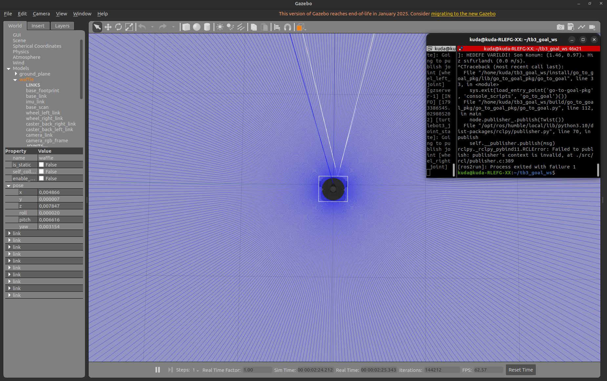
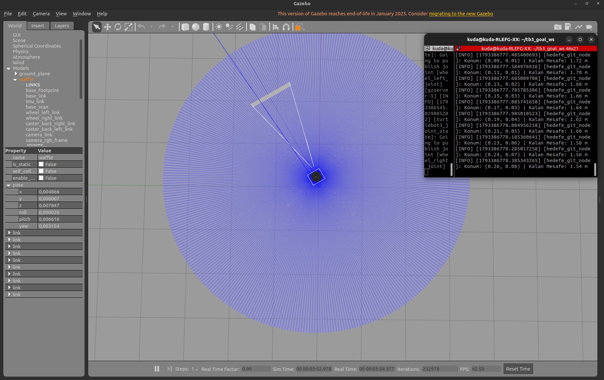
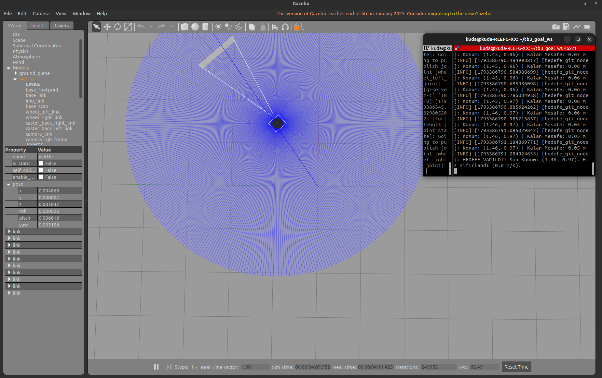
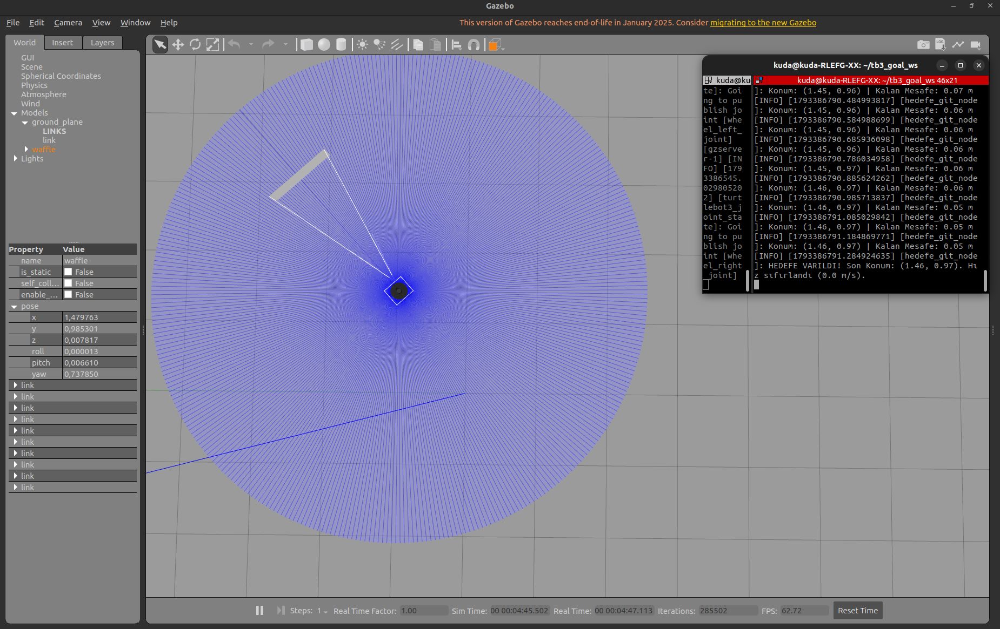

# ROS2 Robot Controller

TurtleBot3'ü Gazebo ortamında, bir Python (rclpy) node'u ile belirlenen bir noktaya götüren ROS 2 Humble paketi.

## Nasıl çalışır?
- Node, `/odom` topic'ine abone olarak robotun konumunu ve yönünü okur.
- Hedefe olan mesafe ve açı hatasına göre oransal kontrolle hız hesaplar ve `/cmd_vel` topic'ine `Twist` mesajı yayınlar.
- Robot hedefe 5 cm'den fazla yaklaşınca hız komutu sıfırlanır (`0.0 m/s`) ve node hareketi bitirir.
- Hedef nokta `/odom` çerçevesinde **(1.5, 1.0)**. Robot başlangıçta (0, 0) konumunda ve x ekseni yönüne baktığı için hedef, başlangıçla aynı doğrultuda değildir.
- Ortam engelsizdir (`empty_world`).

## Gereksinimler
- Ubuntu 22.04
- ROS 2 Humble
- Gazebo ve TurtleBot3 paketleri:

```bash
sudo apt install ros-humble-turtlebot3 ros-humble-turtlebot3-msgs \
  ros-humble-turtlebot3-gazebo ros-humble-gazebo-ros-pkgs
```

## Kurulum
```bash
mkdir -p ~/tb3_goal_ws/src
cd ~/tb3_goal_ws/src
git clone https://github.com/VeyisCeylan0/ROS2_Robot_Controller.git
cd ~/tb3_goal_ws
colcon build --symlink-install
```

## Çalıştırma
**Terminal 1** (Gazebo, engelsiz ortam):
```bash
export TURTLEBOT3_MODEL=waffle   # burger da olur
ros2 launch turtlebot3_gazebo empty_world.launch.py
```

**Terminal 2** (node):
```bash
cd ~/tb3_goal_ws
source install/setup.bash
ros2 run go_to_goal_pkg go_to_goal
```

Robot hedefe gidip durunca terminalde `HEDEFE VARILDI` yazısı çıkar. Node'u `Ctrl + C` ile kapatabilirsiniz.

Hedefi değiştirmek için `go_to_goal_pkg/go_to_goal.py` dosyasındaki `hedef_x` ve `hedef_y` değerlerini düzenleyin. Gazebo'yu yeniden başlattıktan sonra çalıştırın, çünkü `/odom` robotun o anki başlangıcından (0, 0) olarak başlar.

## Gazebo görüntüleri
| Başlangıç | Hareket |
|---|---|
|  |  |

| Varış | Varış konumu (x=1.48, y=0.99) |
|---|---|
|  |  |
